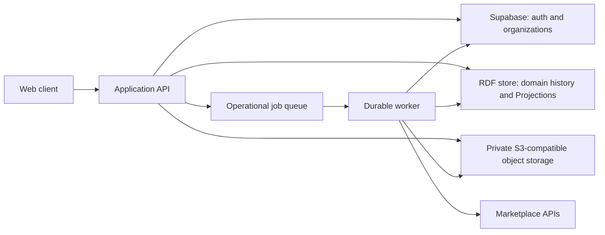

# Tover v2 architecture

- Status: specification draft.
- Review date: 2026-10-09.
- Agreed domain foundation: RDF.
- [Product requirements](product-requirements.md) define the domain contract and terminology.
- [Client UI specification](client-ui-spec.md) defines interactions.
- [RDF machinery](rdf-machinery.md) defines temporal, validation, reporting and synchronization contracts.
- `[UNCLEAR] Q-19`: RDF store, deployment topology and operating targets.
- `[UNCLEAR] Q-01`: first production rollout.

## System boundary

- Tover owns accepted inventory history and its explanations.
- Marketplaces and user files supply Evidence statements.
- Validate and accept proposed Operation revisions before changing the ledger.
- Preserve earlier responses after newer captures.
- Do not override a confirmed physical movement solely because newer data arrived.
- Build the v2 application and server-rendered UI in Clojure.
- Use Datastar for rendering transport and browser events, with Hyper for the first local slice.
- The [first working Stock page](../README.md) uses embedded RDF4J NativeStore provisionally. Q-19 remains open for production storage and topology.
- Start with one application service and a durable worker.
- Use the worker for imports, reconciliation, Projection builds and exports.
- Permit shared code and deployment infrastructure.
- Separate services only when measured load or isolation requires them.

- Expose application APIs, task progress and evidence-linked results to the client.
- Keep RDF credentials and privileged Supabase credentials server-side.
- Do not expose unrestricted SPARQL access to the client.

## Data ownership

| Owner | Authoritative data | Boundary |
|---|---|---|
| RDF store | Physical objects, Resource specifications, Accounts, Listings, identifiers and Locations. Operations, review history, Evidence and lineage. | Single inventory and provenance authority. Derive current balances. |
| RDF store | Domain commit receipts, pending external intents, report manifests and Projection metadata. Financial facts, valuations and cost policies. | Preserve domain meaning and durable acceptance evidence. |
| Supabase | Users, organizations, memberships, authentication, invitations and role permissions. | Identity and permission authority. Link RDF actor references to these IDs. |
| Supabase operational tables, if needed | Connector secret references, job schedules, leases, retry state and delivery attempts. | Execution bookkeeping. Reconcile completion through RDF receipts. Do not duplicate inventory authority. |
| Private S3-compatible storage | Original uploads, retained API response files, attachments and report exports. | Binary content. RDF owns Evidence metadata and domain links. `[UNCLEAR] Q-14`: permitted-content and retention boundaries. |
| Versioned semantic package | Application vocabulary, selected ontology axioms, shapes, rules, connector mappings and report query definitions. | Immutable releases. Record exact versions and checksums in RDF. |
| `[UNCLEAR] Q-17` | Comments, chat, message attribution and durable discussion anchors. | Assign an authoritative owner before implementing persistent collaboration. |

- Treat accounting integrations as attributed claims.
- Do not introduce a competing inventory ledger.
- Preserve unknown costs as unknown.
- Do not use zero as a migration cost default.
- Declare versioned cost allocation before composition or transformation reports rely on it.
- Keep connector credentials in server-side secret storage.
- Exclude reusable secrets from Evidence graphs and retained files.
- Keep domain settings and custom rule versions in RDF.
- Permit operational storage for UI preferences without domain effects.
- Require a clear owner and purpose for each additional Postgres table.
- Do not duplicate domain truth in operational tables.

## RDF dataset and graph layers

- Use stable, opaque application IRIs for Physical objects, Operations, Listings and Evidence.
- Keep external IDs as scoped values with assignment history.
- Assign each domain record to one Workspace.
- Distinguish Physical objects, Listings and Resource specifications.
- Link known origins to Operation lines that record physical arrival or production.
- Retain purchase, return, transfer, production, defect, sale, write-off and payment as operation types.
- Use production for assembly, disassembly, reassembly, repair and rework.
- Handle inventory adjustment through inline manual edits.
- Do not add operation types for production actions, physical arrival or manual edits.
- Model assembly, disassembly and reassembly through production inputs and outputs.
- Create new Physical object IDs for their outputs.
- Retain consumed input IDs only in history and lineage.
- Record each current item's Location directly.
- Do not infer entity equivalence from the client label Goods.
- Use one Account model for selling and source contexts.
- Record provider, roles and scoped external references.
- Keep distinct real accounts separate.
- Keep Account associations independent of physical Location.
- Support account-scoped identifiers and connections without a universal one-account-per-provider limit.
- `[UNCLEAR] Q-10`: Account roles and legacy mappings.

| Logical graph layer | Contents | Mutation policy |
|---|---|---|
| Evidence | Original captures, normalized statement revisions, file metadata, scope, completeness and failures. | Append captures and parsing revisions. Preserve source-position and parser references. |
| Proposed changes and review | Proposed Operation revisions, manual edits, alternatives, validation findings and decisions. | Create immutable revisions for edits. Append review decisions. |
| Accepted domain history | Accepted Operation revisions, manual edits, Evidence links, actors, times, corrections and commit receipts. | Append immutable history. |
| Semantic packages | Released vocabulary, ontology, shapes, rules, mappings and query versions. | Keep releases immutable. Record activation decisions. |
| Derived views | Projections and reconciliation results with revision, cutoffs and semantic versions. | Replace completed views under publication controls. |

- Treat graph naming and partition size as store implementation choices.
- Do not require one graph per triple or object.
- Record acceptance through an explicit domain decision.
- Do not infer acceptance from an ontology.
- Distinguish normalized Evidence statements from accepted changes and derived conclusions.
- Preserve manual edits' previous values, accepted effects, actor, reason, Evidence and both times.
- Apply the command and acceptance contracts to Operations and manual edits.
- Derive inventory from accepted history rather than direct balance overwrites.
- `[UNCLEAR] Q-20`: accepted manual-edit encoding.
- Keep aggregate marketplace Evidence aggregate when individual attribution lacks support.
- Named graphs organize the dataset.
- Enforce access control separately from graph names.
- Enforce query and reasoning boundaries separately.

## Semantics and rules

- Use RDF as the shared representation.
- Use SPARQL for approved reads and controlled updates.
- Define entity meanings, relationships, identifier scope, units, times and provenance in the application schema.
- Reuse a small [PROV-O](https://www.w3.org/TR/prov-o/) profile for Evidence and derivation.
- Reuse selected [Valueflows](https://www.valueflo.ws/specification/spec-overview/) resource and event concepts.
- Keep explicit mappings to [EPCIS](https://ref.gs1.org/standards/epcis/2.0.1/) aggregation, transformation, movement and correction concepts.
- Do not claim EPCIS compliance from term mappings.
- Do not import entire ontologies for a few terms.

| Mechanism | Responsibility | Example |
|---|---|---|
| RDFS and bounded [OWL](https://www.w3.org/TR/owl2-overview/) | Vocabulary mappings and stable semantic entailments. | Physical object maps to an economic resource. Operation maps to an economic event. |
| [SHACL](https://www.w3.org/TR/shacl/) | Validate specified graphs. Use SPARQL constraints where needed. | Check Operation Evidence and times. Reject unavailable inputs and cycles in consumed-input/new-output lineage. |
| Ordered SPARQL rules | Temporal selection, corrections, state derivation and provenance. | Derive effective Operation and manual-edit effects, production lineage and identifier intervals. |
| Application commands and transactions | Authorization, concurrency, persistence, external calls and acceptance decisions. | Accept a reviewed Production operation once against the expected Workspace revision. |

- Start with the smallest tested RDFS/OWL subset.
- Treat OWL RL as a candidate profile.
- Do not enable unrestricted reasoning by default.
- OWL uses open-world semantics.
- OWL does not enforce complete records or select the latest Operation.
- OWL does not execute stock transitions or resolve ambiguous identifiers.
- Do not use `owl:sameAs` for marketplace identifiers or candidate matches.
- The proof uses [SHACL-AF SPARQL rules](https://www.w3.org/TR/shacl-af/#rules) through pySHACL.
- Treat the proof as a reusable policy reference.
- Do not require the proof engine for every production request.
- Execute rules inside the selected store only after semantic parity checks.
- Use a bounded external worker when store capabilities cannot satisfy the contract.
- Distinguish SHACL validation from SHACL-AF rule execution.
- SHACL-AF has Working Group Note status.
- Do not infer SHACL-AF support from SHACL support.
- `[UNCLEAR] Q-20`: final semantic subset, reasoner, namespace and Operation encoding.

## Commit and Projection consistency

### Command contract

- Maintain an accepted-history revision for each Workspace.
- Require domain idempotency key, expected revision, exact proposed change revision and semantic package version.
- Bind the key to Workspace, command type and canonical input digest.
- Return the recorded receipt for identical key reuse.
- Reject key reuse with different input.
- Verify authorization and Evidence before acceptance.
- Validate the proposed Operation or manual-edit structure against the expected revision.
- Validate immediate-before-state and transition preconditions against that revision.
- Validate resulting state against that revision.
- Validate affected later transitions for backdated Operations and corrections.

### Acceptance contract

- Atomically record the accepted Operation or manual edit, decision, domain commit receipt and new revision.
- Use serializable transactions or equivalent compare-and-swap protection.
- Prevent concurrent writers from changing the validated baseline before commit.
- Repeat validation against the new revision after a failed comparison.
- Retain the exact reviewed change revision during retries.
- Require renewed review when refreshed selections or business effects change.
- Do not substitute a different production Operation or manual edit during retry.
- Do not rely on process-local locks for persistence consistency.
- Do not follow validation with an unconditional RDF update.
- Resolve uncertain acceptance responses through durable receipts.

### Projection contract

- Read a stable accepted-history revision.
- Apply Operation and manual-edit effects together in explicit business order.
- Build a fresh Projection.
- Publish only a completed Projection matching the intended revision and semantic version.
- Prevent late builders from replacing newer published views.
- Label the last completed revision while new calculations remain pending.
- Do not present partially rebuilt graphs as current state.

### Historical reports

- Pin a completed Projection or a fixed history revision.
- Pin business cutoff B and knowledge cutoff K.
- Pin the semantic package and report query versions.
- Pin Evidence statement, mapping and decision versions through Evidence horizon E or immutable input IDs.
- Include only inputs durably recorded by K.
- Use the then-active policy for actual earlier belief.
- Label newer-rule reinterpretations separately.
- Generate rows, totals, Evidence references and exports from the same view.
- Append corrections to history.
- Build a new view after correction.
- Preserve existing report manifests.
- `[UNCLEAR] Q-05`: occurrence precision and conflicting Operation/manual-edit order.
- `[UNCLEAR] Q-06`: correction branches, dependent Operations and cutoff-crossing behavior.

## Files, jobs and external systems

### Uploaded Evidence

- Use unique private object keys.
- Verify persisted object existence, length and checksum before accepting Operations that rely on those files.
- Record object versions where supported.
- Record checksum algorithm, media type, uploader, capture time and source context in RDF.
- Checksums detect byte changes.
- Checksums do not prove source statements.
- Verify the selected provider's checksum and version semantics.
- S3 compatibility does not guarantee every [AWS integrity feature](https://docs.aws.amazon.com/AmazonS3/latest/userguide/checking-object-integrity-upload.html).
- `[UNCLEAR] Q-14`: permitted original content, retention, redaction and unavailable-Evidence behavior.

### Recovery boundaries

- No distributed ACID transaction spans RDF, Supabase and object storage.
- Uploads can leave unreferenced objects.
- Committed Operations can leave stale operational job status.
- Reconcile these cases through durable references and RDF commit receipts.
- Keep referenced Evidence retrievable under the retention policy.
- Check object references and age before temporary cleanup.
- Preserve an honest record when Evidence becomes unavailable under an authorized policy.

### Durable jobs

- Use retryable, idempotent domain operations.
- Treat leases and completion flags as execution bookkeeping.
- Verify inventory effects through RDF receipts.
- Return existing receipts for duplicate delivery.
- Append changed source records as new Evidence statement versions.
- Permit new proposed Operation revisions for changed source meaning.
- Do not discard changed records as duplicates.
- Do not overwrite earlier Evidence statements.
- Separate capture identity from business-occurrence identity.
- `[UNCLEAR] Q-09`: occurrence and Operation-line equivalence across sources.

### Marketplace boundary

- Begin with inbound, read-only synchronization.
- Require a separate authorized command for Listing publication or other external mutations.
- Record durable outbound intent with its domain commit in RDF.
- Dispatch the intent through a worker.
- Retain intent, payload version, request, response and verification Evidence.
- Reconcile uncertain responses before retrying operations with repeatable side effects.
- Rebuild operational queues from pending RDF intents when needed.
- Do not lose accepted external work between commit and queue delivery.
- Do not promise exactly-once execution across an external marketplace.
- `[UNCLEAR] Q-07`: permitted external mutations and authorization rules.

## Authorization and isolation

- Validate Supabase sessions server-side on every protected request.
- Resolve current Workspace membership and permissions server-side.
- Verify delegated worker authority and current connection/policy state.
- Do not grant permanent authority through an old token or queue row.
- Use Supabase as the permission authority.
- Do not grant access from copied RDF memberships.
- Do not authorize through user-editable metadata.
- Do not assume cached JWT claims immediately reflect membership changes.
- Constrain RDF access to the authorized Workspace and approved templates.
- Reject cross-Workspace subjects, references and graph targets at the write boundary.
- Scope imports, reasoning, validation, reporting and exports to one Workspace and approved shared semantics.
- Do not include every tenant graph in a default query dataset.
- [Supabase RLS](https://supabase.com/docs/guides/database/postgres/row-level-security) protects Supabase rows.
- Enforce RDF and object-storage authorization separately.
- Keep privileged RDF, Supabase and storage credentials server-side.
- Issue short-lived signed Evidence URLs only after current Workspace authorization.
- Do not treat object keys or graph names as authorization secrets.
- Do not expose raw RDF updates or public SPARQL endpoints to ordinary users.
- Do not permit arbitrary executable tenant rules.
- `[UNCLEAR] Q-07`: propose, approve, reject, correct and override permissions.

## RDF store selection

- Select the store through a bounded acceptance test.
- Do not select a vendor solely from the lifecycle proof.

| Required capability | Acceptance evidence |
|---|---|
| RDF datasets | Named graphs, RDF import/export and SPARQL 1.1 query/update. Documented transactions and stable reads. |
| Concurrent acceptance | Atomic acceptance and safe completed-Projection publication under competing writers and retries. |
| Workspace isolation | Enforced query/update boundaries, scoped inference and operational limits. Graph names alone cannot provide ACLs. |
| Query performance | Predictable indexes/plans for identity lookup, temporal selection, production lineage and aggregation. |
| Recovery | Tested history, semantic-version and Projection-pointer backup/restore with Evidence object references. |
| Semantic parity | Required bounded inference, SHACL and ordered-rule semantics through the store or worker. Reproducible results. |

- Benchmark representative Operation volume, correction depth, production-lineage depth and Workspace count.
- Measure acceptance latency, Projection rebuild time, report latency and memory.
- Optimize incremental materialization only after parity with fresh reconstruction.
- Include stale-conclusion removal in parity checks.
- `[UNCLEAR] Q-19`: vendor, tenancy layout, retention limits and service targets.
- Establish an affordable operating envelope before fixing those choices.

## Migration and delivery gates

### Proof boundary

- Reference: [experiment README](../experiments/inventory-rdf/README.md).
- The proof passed 196 checks, including 92 complete-graph comparisons.
- Its 743 real records provide aggregate Evidence.
- Its physical lifecycle uses constructed data.
- The proof supports semantic direction and temporal policy.
- Its packing cases use the previous containment model.
- Verify item-changing assembly, disassembly and reassembly against the revised contract before claiming lifecycle parity.
- The proof does not establish durability, throughput or complete Ozon reconstruction.

### Migration contract

- Import legacy balances and mirrors as Evidence or explicitly reviewed opening balances.
- Preserve actual certainty and tracking granularity.
- Preserve legacy IDs as scoped references.
- Do not invent purchases, individual identities or warehouse movements for historical tracing.
- Preserve unknown physical origins.

### First implementation gate

- Proposed path: purchase arrival, physical identity, production, transfer, evidence-linked report and late correction.
- `[UNCLEAR] Q-01`: selected first lifecycle and compatibility scope.
- Resolve the selected tracking mode and physical-binding process before implementing that path.
- Resolve quantity precision and occurrence precision before accepting its Operations.
- Resolve applicable production identity effects and correction semantics.
- Resolve propose/accept permissions.
- Define its schema and Operation encoding.
- Demonstrate atomic acceptance, idempotency, stable reads and safe Projection publication against the selected store.
- Gate additional capabilities by their own unresolved policies.

### Domain cutover gate

- Compare inbound synchronization alongside the current system.
- Reconcile the selected Workspace before switching domain writes.
- Record an explicit cutover point.
- Avoid prolonged dual inventory masters.
- Retain recovery and export procedures.
- Make unresolved gaps visible at cutover.
- Prove isolation, concurrency, Evidence recovery and reproducible reports before operational authority transfers.
- Keep marketplace writes, broad accounting integration and unrestricted rule authoring behind separate acceptance gates.

- Unresolved decisions: [clarifying questions](product-requirements.md#clarifying-questions).
