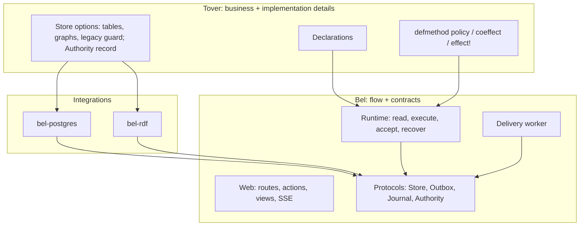

# Bel architecture: target picture and alignment plan

Status: draft for alignment, 2026-11-11. Nothing here is implemented unless marked **(now)**. It complements the [DSL proposal](bel-dsl-proposal.md), [milestones](bel-next-milestone.md) and [onboarding mapping](bel-onboarding-mapping.md); where they disagree on framework structure, this document is the proposed direction.

## 1. Intent

Business requirements are written as Event Modeling chapters in prooph board (workspace `ec484260-1c12-45d7-a8a7-f0af8e2fc520`). Bel exists so that a board slice translates into code almost mechanically, and so that everything the board does not talk about — transactions, retries, idempotency, journal, delivery, authorization timing — is owned by the framework.

Tover keeps two kinds of code only:

1. **Business declarations**: what the board says — screens, intents, commands, events, information, automations, access rules.
2. **Implementation details**: how Tover's concrete world looks — table bindings, graph naming, session lookup, app-specific coeffects and effects.

Tover never writes flow: no transaction opening, no receipt handling, no retry logic, no delivery loops.

### Anti-goals

- A framework bigger than the features it carries. Every option must remove repeated wiring or carry a board-level rule.
- Validation for its own sake. Bel checks what protects data or business guarantees; misconfiguration may surface at first use with a clear `:configuration` error.
- A second architecture hidden in adapters. Adapters do storage mechanics, never flow decisions.
- A big-bang rewrite. Legacy live routes keep working until each chapter's cutover.

## 2. Event Model → Bel mapping

| Board element | Bel declaration | Notes |
| --- | --- | --- |
| Chapter (context) | Domain folder, e.g. `tover.workspaces` | |
| Slice | Feature namespace pair `…/<slice>/model.clj` + `web.clj` | **(now)** `workspaces.create`, `catalogues.rename`. |
| UI | `defpage` / `defview` | Renders data only. |
| User intent on UI | `defaction` | Transport input → command descriptor with `:then`/`:catch`. |
| Command | `defcommand` | Pure `[facts input] -> {:events :fx}`. |
| Event | `defevent` | Immutable payload schema. |
| Information | `defreadmodel` | Composed authorized read, possibly across stores. Entity state behind it is `defmodel`. |
| Automation | `defprocessor` | Todo-list automation: polls a Tover coeffect for due work and returns command requests only. |
| Translation | Inbound processor (later) | Marketplace sources. |
| User lane | Policy id, e.g. `::confirmed-user` | |
| System lane | Store key: `:directory` or `:catalogue` | Many lanes to one store: Workspace Directory, Workspace Session and Invitations all use `:directory`. |
| External system lane | Effect id, e.g. `:email/send` | |
| Hotspot | Not code | Stays on the board until decided. |
| Given/When/Then | Scenario test against the pure command | §8. |

One structural rule follows from the board: **a command writes to one store.** All events it emits map to models of one store, which gives one atomic acceptance. Cross-store *writes* are automations. Cross-store *reads* are allowed everywhere (§6.4).

## 3. Layers and ownership



Tover → Bel ← Integrations. Tover constructs integrations. Integrations never require Tover or each other. Bel requires neither.

## 4. Extension mechanisms

**Open app vocabularies are multimethods; infrastructure capabilities are protocols; single implementations are constructor options.**

| Today | Becomes | Why |
| --- | --- | --- |
| `runtime/coeffect`, `runtime/effect!`, `runtime/policy` | multimethods (keep) | Open, app-specific sets keyed by qualified id. Policy ids mirror user lanes. |
| `expressions/expand-form` | multimethod (keep) | Syntax extension. |
| `runtime/snapshot`, `runtime/accept!` | plain functions | The flow is not overridable. |
| `load-model`, `apply-model!`, `open-transaction` | `Store` | Adapter object holding its resource. |
| `acceptance`, `save-acceptance!`, `pending-records`, `read-record`, `acknowledge!` | `Outbox` | Only stores that cannot share the journal's transaction. |
| `read-receipt`, `write-batch!`, `read-history` | `Journal` | |
| `runtime/authority` | `Authority` | One Tover record in the system map. |
| `runtime/check-source!`, `bel-rdf.adapter/graphs` | RDF store options `:guard`, `:graphs` | One implementation each. |
| `bel-postgres.adapter/model-binding` | Postgres store option `:tables` | Data. |

Result: 4 `defmulti` (from 22), 4 protocols, 0 `defmethod` on adapter concerns in Tover.

Id namespaces: `:bel/*` framework, `:rdf/*`/`:postgres/*` integrations, Tover its own (`::membership`, not `:postgres/membership`).

## 5. Framework contracts

The guarantees Bel owns. Each lives in one place.

| # | Contract | Where |
| --- | --- | --- |
| C1 | Authorization happens inside the owning transaction, before receipt recovery or business reads. Retries are re-authorized. | `runtime/accept`, `runtime/snapshot` |
| C2 | `(scope, command-id)` identifies an invocation. A matching request returns the original result; a different one fails with `:idempotency-conflict`. A decision never runs twice. | `runtime/recover` |
| C3 | Model mappings and the journal batch (colocated) or outbox record (separate) commit together in the owning store. | `runtime/accept` |
| C4 | The outbox delivers exactly the recorded batch, never reruns a decision; identical redelivery succeeds, different content stays pending. | `bel.delivery` |
| C5 | An event's `:set` fields replace those fields on the entity named by the payload identity; other fields stay. `:create` inserts a complete entity and refuses an existing identity with `:identity-conflict`. Same meaning on every store. | `Store/-write!`, `Store/-create!` |
| C6 | Effects run after commit, best effort, may repeat; never affect acceptance. A descriptor `{:id :input :then :catch}` runs only after a fresh acceptance and records its outcome through the continuation command. Continuations and processor requests retry a concurrent-change conflict with the same command id (three attempts); an outcome still lost stays unknown and the effect is never rerun. | `runtime/dispatch-effects!` |
| C7 | `:scope`, `:actor`, `:command-id`, `:now` come from trusted context, never input. | `prepare-context` |

Chapter 03 (display name) is the first `:set` update on PostgreSQL; its migration grants the runtime role UPDATE on the mapped columns. Chapters 03/03a are live: every profile name and language writer runs the `tover.accounts.profile` commands. PostgreSQL CHECK violations (SQLState 23514) surface as `:validation`.

Errors use one vocabulary, translated by adapters inside `-transact`: `:validation`, `:forbidden`, `:not-found`, `:conflict` (retryable), `:identity-conflict`, `:idempotency-conflict`, `:journal-unavailable` (retryable), `:journal-conflict`, `:migration-required`, `:configuration`, plus business types (`:stale-catalogue`, `:profile-incomplete`).

## 6. Shape of the pieces

### 6.1 Protocols (`bel.store`)

```clojure
(defprotocol Transactional
  (-transact [this isolation f]           "Run (f tx); translate native errors to Bel error types."))

(defprotocol Store
  (-load     [store tx scope model id]    "Entity map or nil.")
  (-create!  [store tx scope model row]   "Insert a complete entity; existing identity is :identity-conflict.")
  (-write!   [store tx scope model fields row] "Replace the mapped fields; insert when new and complete."))

(defprotocol Outbox
  (-record!  [store tx scope delivery]    "Accepted batch + permanent acceptance marker.")
  (-accepted [store tx scope command-id]  "nil | {:pending delivery-or-nil}")
  (-pending  [store]                      "Seq of {:source s :delivery d} or {:source s :error e}.")
  (-ack!     [store delivery]             "Remove the pending payload; keep the marker."))

(defprotocol Journal
  (-receipt [journal tx scope command-id])
  (-append! [journal tx scope delivery]   "Idempotent; :journal-conflict on different content.")
  (-history [journal tx scope]))

(defprotocol Authority
  (-principal [authority tx identity]     "Lock/verify the current session; return a principal map or throw :forbidden."))
```

Every store, and the journal, is `Transactional`. Bel opens and shares transactions by store key (`:bel/transactions {key tx}`); two keys never share a transaction even over one datasource.

Adapters receive `scope` as `{:kind :workspace :id uuid}`, so they never know Tover key names. Stored requests keep their existing `{:workspace-id …}` shape. Bel keeps its three documented scope kinds (`:user`, `:session`, `:workspace`) and the actor is the trusted `:user-id`. `:scope` stays optional on `defcommand` and `defreadmodel`; the system's `:scope` (Tover: `:workspace`) is the default, so only user and session operations declare one.

The journal names a store key. Colocation is key equality: when the owning store is the journal store, Bel writes the journal in the same transaction; otherwise it calls `Outbox/-record!`. The PostgreSQL record implements both `Store` and `Journal`.

### 6.2 System map

Built once by Integrant, passed to the handler and the delivery worker.

```clojure
(bel/system
  {:stores    {:directory (pg/store  {:datasource ds :tables workspaces.persistence/tables})
               :catalogue (rdf/store {:repo repo
                                      :graphs catalogues.persistence/graphs
                                      :guard  catalogues.persistence/legacy-guard})}
   :journal   :directory
   :scope     :workspace
   :authority {:store :directory :impl (auth.bel/->CurrentSession)}
   :resources {:realtime realtime}})   ; for effects only
```

- A store is one transactional resource, not a domain or entity. Two stores; new entities do not add stores. The RDF store is generic: vocabulary comes from `defmodel`, its only configuration is graph naming per scope.
- RDF adapter scope stays narrow until a slice needs more: scalar fields, scoped SELECT through `:rdf/query`, no recursive reference loading. Native UUID/time literals are a known gap.
- Every `defmodel` declares `:store`. A command's owning store is the store of the models its events map to.
- The delivery worker takes the system and polls each `Outbox` store.

### 6.3 What hooks receive

| Hook | Receives |
| --- | --- |
| `policy` | principal, scope, decoded input |
| `coeffect` | `{:scope :actor :principal}` plus the system; it opens the store it reads with `runtime/with-store`, request |
| `effect!` | `{:scope :actor :resources}`, request |
| `Authority/-principal` | its own `tx`, trusted request identity |
| store options | scope, own `tx` |

The principal is the plain map `-principal` returns (for Tover: user id, confirmation, password-required, memberships). Policies read it instead of arbitrary context keys. No datasource, open-transaction table or other store's handle reaches business code.

### 6.4 Cross-store reads

A read model can compose models and read models from any store, and commands can use such reads as coeffects.

- Each store touched during one operation is opened once, on first use, and held until the operation ends (the mechanism **(now)** used for authority). All reads from one store see one snapshot.
- There is no snapshot across stores. Two stores are each consistent, not mutually consistent.
- In a command, reads from another store are facts *as read*; they are not serialized with the owning write. A rule that must hold at commit — such as "membership still active" — belongs to the authority (which holds its locks through commit) or to data in the owning store. Everything else is ordinary staleness, handled like any stale form input.
- Model lookups resolve their store from `defmodel :store`. An operation opens, up front, the stores of every model it references (commands: owning store first). Coeffects reach a store through `(runtime/with-store ctx :directory isolation f)`, which joins that store's open transaction or opens a short one just for `f`. Integration coeffects find their own store: `:rdf/query` uses the system's RDF store.

### 6.5 The flow

```
execute!  decode → definition → owning store
  accept  Store/-transact owning :serializable
            principal  ← Authority (joined if same resource, else held through commit)
            C1 policy
            C2 recover  ← Journal/-receipt | Outbox/-accepted
            facts       ← coeffects (owning tx; other stores opened on first use, held)
            plan        ← pure handler, checked against :emits
            Store/-write! per event mapping
            Journal/-append! | Outbox/-record!
  after commit: dispatch-effects!
```

`read-model` is the same up to `facts`, inside repeatable-read snapshots.

## 7. Coexistence with legacy code

| Zone | What lives there | Rule while migrating |
| --- | --- | --- |
| Shared Bel web layer | `defpage`, `defview`, `defaction`, `defstream`, handler, realtime | Used by both zones; changes keep legacy views working. |
| Legacy live routes | `tover.catalogues.store`, `tover.stock`, `tover.inventory.*`, `tover.auth.web` + `Auth`, `tover.workspaces.web` + `Directory` | No new features for chapters on the board; bug fixes only. `Auth`/`Directory` stay as Tover details and later back Auth effects. |
| Bel slices | `*.create`, `*.rename`, future chapter slices | Excluded from discovery until their chapter's cutover. The exclusion is the switch. |

1. **Replace, don't shim.** The runtime is used only by isolated slices and tests, so protocol changes replace multimethods directly.
2. **One writer path per chapter.** A chapter goes live only when every writer of its data switches together.
3. **The board is the backlog.** A slice is migrated when its chapter has no blocking hotspots; `bel-onboarding-mapping.md` tracks status.

## 8. Board-driven loop

1. Read the chapter: lanes → policies and stores, elements → declarations.
2. Write scenarios from the slice's examples: Given facts, When input, Then events or an error type.
3. Write declarations and the pure handler until scenarios pass.
4. Add implementation details: table bindings, graph naming, app coeffects.
5. Integration tests only for store-specific behavior.

`bel.runtime/decide` (P1) is the scenario helper: it runs a command's handler with given facts and input through the same plan check as the runtime (`:emits`, event schemas, effect ids) and returns the plan or the thrown error. No store, no registry fixture beyond the command's own namespace.

```clojure
(is (= [::good-renamed] (map :type (:events (decide ::rename-good {:good {...} :actor a} {:id "G" :revision 4 :name "Nut"})))))
```

## 9. Migration plan

Each phase keeps all tests green.

| Phase | Change | Done when | Unblocks |
| --- | --- | --- | --- |
| P0 | Agree this document. | Approved. | — |
| P1 Protocols and flow — done 2026-11-11 | Add the protocols; adapters become records with `:tables`/`:graphs`/`:guard`; `accept`/`snapshot`/`recover` become functions; delete the storage multimethods; `runtime_test`'s `::memory` overrides become a small test `Store` record; add `bel.runtime/decide`. `:rdf/query` keeps its request shape (no store option). | Only `coeffect`, `effect!`, `policy`, `expand-form` remain as `defmulti`; `scripts/test-bel-workspace.sh` and unit suite green; Tover declarations unchanged except `:store`. | P2, P3 |
| P2 Upsert (C5) — done 2026-11-11 | Mappings are `{:create […]}` (plain insert, `:identity-conflict` on an existing entity) or `{:set […]}`; `-write!` upserts on both adapters (Postgres `UPDATE` of the mapped columns, then `INSERT` only when no row exists and the entity is complete; updates need only UPDATE privilege); Create Workspace uses `:create`. | Postgres update-event integration test. | Chapter 03 |
| P3 Principal — done 2026-11-11 | Authority record returns principal; policies read it; hook contexts trimmed (§6.3); `:postgres/membership` → `::membership`, `:postgres/receipt` → `:bel/receipt`. | Both slices' policies use principal only. | Chapter 03 |
| P4 System — done 2026-11-11 | `bel/system` and delivery worker as Integrant keys in `tover.app` (`::bel-system` reaches the handler as `:bel/system`; `::journal-datasource`, `::delivery-system` and `:bel.delivery/worker` exist only when both `TOVER_JOURNAL_DB_USER` and `TOVER_JOURNAL_DB_PASSWORD` are set); `runtime-config`/`delivery-context` were already deleted in P1. | Dev system starts with slices excluded; worker running. | Any cutover |
| P5 Chapter 03/03a — done 2026-11-12 | Profile, name, language built on the new structure via §8. `/account/profile` and the signed-in language switch execute `set-display-name`/`change-account-language` (`:user` scope); signed-in users without a name are sent there first. Requests read identity, language, profile completeness and memberships from access-token claims (migration 037 hook) instead of calling Auth and the directory; the `:tover.auth/refresh-claims` effect reissues the actor's session tokens after a profile change. | Board scenarios pass; profile writers cut over. | Validates the design on an update flow |
| P6 Processors and effects — done 2026-11-12 | `defprocessor` (todo-list automations run by the delivery worker under a service principal `{:service id}`, with command ids derived from the request), effect descriptors with `:then`/`:catch`. Chapter 05 is an isolated slice (`tover.invitations`, excluded from discovery): Invite Teammate, the invitation delivery processor with a durable four-attempt budget, Invitation Status, and an SMTP mailer sharing Auth's relay. Migration 038 adds `invitation_deliveries`, gives the worker login narrow invitation reads and delivery updates, and lets the runtime role journal workspace-scoped directory commands. | Chapter 05 delivery scenarios. | 05, 05a, 05b, 01, 02 |

## 10. Decisions (2026-11-11)

1. `policy` stays a multimethod.
2. Every `defmodel` declares `:store`.
3. Read models may join data across stores and are usable from views and commands (§6.4).
4. Authority is a protocol.
5. The scenario helper ships in P1.

## 11. Deliberately not doing

Dropped from the earlier draft as premature:

- Startup completeness checks (every policy/coeffect/effect/binding resolved, `Outbox` presence). Missing pieces fail at first use with `:configuration`, as today.
- Declaring `:effects` on commands. The existing plan check against registered `effect!` methods stays.
- A Malli schema for the principal.
- A one-store-per-read rule, an in-memory production store and a shared adapter contract-test suite. Adapter behavior is covered by their integration tests; flow by unit tests with a test `Store`.
- Multimethod shims and a two-step protocol migration.
- Configurable scope kinds and a default store.
- A separate `bel.errors` namespace; the vocabulary in §5 is enough.
- Moving `bel-postgres.jdbc`'s global next.jdbc setup to startup; revisit if legacy code is affected.
- Collections, nested records and richer RDF queries.

Existing checks stay where they protect data or business guarantees: declaration shape at load, event-to-model mapping validity, plan and event validation, hostile SPARQL rejection, legacy-graph guard, receipt and batch comparison.
