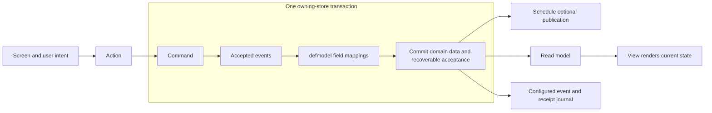

# Bel architecture and DSL

Status: isolated Goods rename and Create Workspace slices. Production routes and existing data remain unchanged. See the [milestones](bel-next-milestone.md) for executable checks and [onboarding mapping](bel-onboarding-mapping.md) for remaining chapters. The [architecture](architecture.md) and [RDF contract](rdf-machinery.md) govern live behavior until cutover. Native models, command requests, composed reads, named scopes and best-effort publication are implemented. PostgreSQL is the shared journal for both slices. Goods keeps native RDF domain data and delivers its accepted batches through durable source records. Auth effects and general processors remain proposed.

## Goals

1. Keep feature implementation predictable: idiomatic Clojure, clear modules, few places to edit.
2. Carry the same business concepts from stakeholder discussion into code and tests.
3. Make dependencies and composition explicit while keeping decisions, I/O and rendering separate.
4. Make accepted changes explainable and safe under failures, retries and concurrent work.

Simplicity is a constraint on every addition. A declaration must remove repeated wiring or enforce a useful boundary. Keep calculations and business rules in ordinary functions. Judge the design by a complete feature, not by the number of framework capabilities.

## The feature path



An Event Modeling scenario names the screen, intent, accepted facts and resulting information. Those names map to declarations and scenario tests. Include rejection, stale input and retry paths. Declarations expose possible relationships; examples establish the actual conditional behavior.

When domain and journal use the same transactional resource, both commit together. Otherwise the source commits domain changes and durable delivery state, then Bel delivers the accepted batch through the journal contract. Delivery may lag; domain acceptance remains recoverable. Tover currently exercises these paths with PostgreSQL-only workspace creation and RDF-to-PostgreSQL Goods delivery.

## Responsibilities

| Element | Owns | Returns |
| --- | --- | --- |
| Action | Translate browser intent into a command request. | Command descriptor, existing Bel instructions or a Ring response. |
| Command | Decide from declared facts and validated input. | `{:events [...] :fx [...]}`. |
| Event | Describe an immutable accepted business fact. | Validated domain payload. |
| Model | Declare entity identity, fields, relationships and accepted-event mappings. | Native domain storage and plain entity lookups. |
| Read model | Query authorized data and shape a typed result. | Plain data for commands or screens. |
| View | Render the supplied data. | A plain map for a declared snapshot signal, or existing Bel instructions. |
| Bel runtime | Coordinate authorization, transactions, retry recovery and accepted-event mappings. | Original receipt and repeatable publication requests. |
| Bel delivery worker | Transfer recorded batches to the journal and acknowledge confirmed storage. | Delivery outcome; no new decisions. |
| Adapter | Execute scoped I/O and enforce its transaction/capability boundary. | Native data or a structured error. |

Business calculations remain ordinary Clojure functions. `defmodel` supplies the storage contract; its event mappings copy accepted values without executing business logic. Commands and views receive data; connections and service clients remain infrastructure resources.

Organize code by application domain. Keep declarations beside their schemas and pure domain functions. Bel is the general-purpose framework: declaration validation, invocation, acceptance, delivery and resource coordination. Storage and service implementations are optional integrations outside `bel.*`. The application owns access rules, native-table bindings, graph allocation, compatibility checks and composition.

Dependencies point inward: applications load integrations; integrations implement Bel contracts. Bel never imports application or integration namespaces, JDBC, RDF4J or PostgreSQL classes. One integration never calls another database integration. Bel coordinates their operations. The current integrations are `bel-rdf.*` and `bel-postgres.*`, loaded by Tover's bootstrap; they share this repository but are not framework-core namespaces.

## Core DSL

Declaration IDs are namespace-qualified keywords. Scopes are the unqualified keywords `:user`, `:session` and `:workspace`. Use open Malli maps. New business declarations and read-model bindings reject unsupported options. Reject invalid plan keys and duplicate or reserved coeffect bindings explicitly.

| Declaration | Options | Handler |
| --- | --- | --- |
| `defevent` | `:schema` | Payload declaration. |
| `defmodel` | `:id`, `:schema`, `:policy`, optional `:events` | Data declaration; no handler. |
| `defcommand` | `:input`, `:policy`, `:emits`, optional `:cofx`, `:scope` | `[facts input] -> plan`. |
| `defreadmodel` | `:input`, `:output`, `:policy`, optional `:cofx`, `:scope` | `[facts input] -> data`. |
| `defview` | Optional `:read-model`, `:signal`, and existing view options | Bound views receive `{:model data :input decoded-view-input}`. With `:signal`, return a plain map. |
| `defaction` | Existing action options | `[context input] -> command descriptor or existing response`. |

Declaration shape; the executable feature is in [rename/model.clj](../src/tover/catalogues/rename/model.clj) and [rename/web.clj](../src/tover/catalogues/rename/web.clj):

```clojure
(defevent good-renamed {:schema GoodRenamed})

(defmodel goods
  {:id :id
   :schema Good
   :policy ::workspace-member
   :events {::good-renamed {:set [:name :revision :actor :updated-at]}}})

(defcommand rename-good
  {:input RenameGood :policy ::workspace-member
   :cofx [[:good ::goods by-id]] :emits #{::good-renamed}}
  [facts input]
  ;; The pure domain decision checks existence, name and expected revision.
  {:events [{:type ::good-renamed :data (rename-values facts input)}]
   :fx [[:bel/publish {:topic ::changed :scope-id (get-in facts [:scope :workspace-id]) :data {}}]]})

(defreadmodel good-row
  {:input GoodQuery :output GoodRow :policy ::workspace-member
   :cofx [[:good ::goods by-id]
          [:category ::categories (fn [{:keys [good]} _] {:id (:category-id good)})]]}
  [{:keys [good category]} _]
  (assoc good :labels {:category-id (or (:name category) "")}))

(defview row
  {:schema SaveResponseInput :read-model ::good-row :signal :_catalogueSaveJson}
  [{:keys [model input]}]
  {:commandId (:commandId input) :kind "goods" :status "ok" :row model})

(defaction save
  {:schema Save}
  [_ {:keys [id revision value commandId]}]
  {:type :command :id ::rename-good :command-id commandId
   :input {:id id :revision revision :name value}
   :then {:type :view :id ::row :input {:id id :commandId commandId}}
   :catch {:type :view :id ::failed :input {:commandId commandId}}})
```

Commands return data, not runtime helper calls. `:emits` constrains allowed event types and supplies an explicit Event Modeling link. Missing `:events` or `:fx` means an empty vector. This milestone supports best-effort, repeatable effects such as `:bel/publish`. Unknown effect IDs reject before commit. Handler purity is an authoring and testing contract.

A coeffect is a declared input: `[local-name source-id]` supplies `{}` to its source; `[local-name source-id make-input]` builds the request from `[facts input]`. Sources are models, read models or read adapters. Bindings resolve left to right, so later builders can use earlier results. Constant application values remain ordinary data. Explicit `nil` or a literal map is not a builder.

Trusted facts contain `:scope` and `:actor`; commands also receive `:command-id` and `:now`. User, session and workspace identities are native UUIDs; `:now` is a `java.time.Instant`. Malli decodes transport strings at the boundary. Command IDs remain opaque strings. Bindings cannot replace these facts. Read-model dependencies must be acyclic. Composed reads share one owning-store snapshot; command reads share the write transaction. Each nested operation retains its authorization check.

### Actions return command descriptors

An action that runs a command returns its descriptor and does not call `runtime/execute!`. The handler executes the descriptor and answers with `:then` on success. A test asserts the returned map without a store; an inline call needs a running system and hides the outcome in control flow.

```clojure
(defaction accept
  {:schema Accept}
  [_ {:keys [command-id invitation-id] :as input}]
  (let [path-params {:invitation-id (str invitation-id)}]
    {:type  :command :id ::model/accept-workspace-invitation :command-id command-id
     :input (dissoc input :command-id)
     :then  {:type :page :id ::joined :path-params path-params}
     :catch {:type :page :id ::review :path-params path-params}}))
```

- `:then` is any result: a view, elements, signals or a page redirect.
- `:catch` is a view or a page. A view receives the rejection as `:error`. A page receives only the rejection type name as `:problem`, because page input becomes the URL. Forbidden, configuration, conflict and retryable errors are never caught.
- Without `:catch`, a rejection propagates. Tover form routes then render `:bel/error-page` with the status from the route's `:tover/problems` (`{type status}` or `{type [status message]}`).
- Preconditions on the request, such as "the form's workspace is still the selected one", are checked before returning the descriptor. They do not need `execute!`.

Call `runtime/execute!` in an action only when a descriptor cannot express the work, and name the reason in the docstring:

- the command is one step of a workflow with provider calls or session-store changes around it (sign-in, sign-out, password reset);
- synchronous work after acceptance depends on the receipt (workspace selection closes the previous selection's streams only when it changed);
- the response depends on rejection data that a view or page cannot read back (the profile form shows the latest saved value from the conflict).

Keep such calls in one named function per workflow, not spread through the action body.

### Operation scopes

| Scope | Trusted identity | Examples |
| --- | --- | --- |
| `:user` | `:user-id` | Profile, language, workspace creation, invitation acceptance. |
| `:session` | Safe `:session-id`, never the authentication cookie | Workspace selection and sign-out. |
| `:workspace` | `:workspace-id` | Team, catalogue and inventory changes. |

Bel resolves the declaration's scope from trusted context. Input cannot replace it. Policies determine permission. User operations require an active session but do not depend on workspace selection. Session state is shared by that session's tabs; another device has its own selection. Nested reads retain the transaction scope; incompatible nested scopes reject. Omitting `:scope` retains the bootstrap-configured scope for existing declarations and direct model lookups.

The `:bel/uuid` coeffect supplies a native UUID to a new decision. Matching receipts skip decisions and coeffects. Form command IDs and proposed workspace IDs stay stable across retries.

Read models accept domain query inputs and return domain data. A bound view receives that result as `:model` and its decoded transport input as `:input`. Keep response correlation such as `commandId` in the view input, outside the read model.

A creation-outcome read model uses the command ID as an authorized receipt lookup key. This is domain input, distinct from display-only response correlation.

## Events, current data and adapters

The storage choices in this section describe Tover's configured integrations. PostgreSQL owns users, profiles, workspaces, permissions and sessions. RDF owns catalogue and inventory entities and relationships. PostgreSQL is Tover's single authoritative store for business events and receipts across these domains. Domain data stays native to its owning store. Normal reads query that data; history reads use the shared journal.

Workspace acceptance writes its native rows, events and receipt in one PostgreSQL transaction. RDF acceptance commits its domain changes and durable journal-delivery record together, then delivers the recorded facts and receipt to PostgreSQL idempotently. That local delivery record is recovery infrastructure, not a second authoritative history. A failed delivery cannot undo an accepted change or cause its business decision to run again. Do not use best-effort publication for this path.

The shared timeline retains scope kind/identity, actor, command and event identities. Occurrence time and journal arrival are distinct when delivery is delayed; timestamps do not establish a global causal order. Preserve each command's event order and relevant domain revisions. History access must enforce current scope permissions. Do not add event versions or ordering fields to business handlers.

The journal key includes scope kind, scope identity and command identity. User and workspace scopes cannot collide even when their UUIDs and command IDs match. Current workspace membership governs history reads. The app role cannot insert workspace journal rows; a separate `tover_journal` role can read/insert that history only, without directory, credential or session privileges. Provision its login outside business declarations.

The isolated Goods slice uses `bel-domain` and `bel-delivery` graphs. It refuses writes to scopes with old `bel-events` or `bel-receipts` data; migration requires an explicit cutover. No existing stores or live routes are changed by this milestone.

A model has a required string or UUID identity and an open map schema. Bel supports scalar `:string`, `:uuid`, `:int`, `:boolean`, `:double` and the `bel.validation/Instant` schema. PostgreSQL uses native UUID/timestamp values. The current Goods RDF adapter retains its existing string IDs and timestamps, plus numeric/boolean literals; native RDF UUID/time model fields are not implemented. Optional fields use Malli's `:optional`; absence means no triple or a nullable SQL value. Collections and nested records need an explicit future design. A relationship declares its target model in the field schema:

```clojure
[:category-id {:optional true :bel/ref ::categories} :string]
```

The RDF integration uses `defmodel` metadata to generate a stable RDF class, predicates and workspace-scoped subjects. Ordinary fields are typed RDF literals; references are IRIs to the target model in the same workspace. Reads test membership in the declared RDF class; additional RDF types do not hide an entity. They decode properties into plain maps with string reference IDs. No entity payload blobs, encoders, vocabulary map or feature-specific storage configuration are required. Generated vocabulary describes storage identity and types; it does not invent business ontology or inference rules.

The generated class is `urn:bel:model:<encoded-qualified-model-id>`; predicates append `:field:<encoded-field-key>`. Subjects combine the workspace domain graph, encoded model ID and encoded entity ID. Encoding preserves namespaces and distinguishes punctuation. Model and field names are persistent identities: renaming either requires a migration. Generated vocabulary can be inspected through the adapter's `vocabulary` function.

A model lookup takes its identity key, for example `{:id "G"}`, and returns the entity or `nil`. An explicit `{:id nil}` returns `nil` after authorization, allowing optional reference lookups; an omitted identity is invalid. Each nested model retains its read policy. Writes belong to the authorized command and its accepted event mappings; mappings do not run another business decision or policy. Related models are loaded explicitly through ordered coeffects in the same snapshot; reads do not recursively expand relationships.

For each event, `:events {event-id {:set [fields...]}}` copies those payload fields to the entity identified by the payload's identity key; `{:create [fields...]}` inserts a new entity and fails with `:identity-conflict` when that identity already exists. A mapped event must declare an explicit map schema containing that identity and every mapped field; invalid mappings reject when the registry is built. Fields outside `:set` remain unchanged. An absent mapped optional field removes its old value; the event schema must explicitly declare that field as optional to permit omission. The identity cannot appear in `:set`. The resulting entity must satisfy its schema; a new entity therefore requires all required fields. Mappings cannot make decisions, emit events or schedule effects. Unrelated RDF predicates remain untouched. There are no per-feature mapping functions or candidate validators.

The runtime owns event identity, scope and audit metadata. PostgreSQL stores native UUID/timestamp metadata and a structured JSONB payload; receipts and repeatable effect requests use Nippy bytes. Workspace UUIDs and instants become strings at the JSON boundary; JDBC model values retain their native types. Goods preserves its existing domain text audit fields. Its pending delivery batch uses Nippy Base64 in RDF only until PostgreSQL confirms storage; the canonical events and receipt live in PostgreSQL. Its rename event records accepted rename fields rather than copying unchanged article, barcode or relationships.

Domain revisions and event order must be sufficient to reconstruct event-sourced state. Event names need no explicit version suffix. Preserve stored meaning and input decoding across deployments or provide an explicit migration. Keep history and receipts until a retention policy preserves reconstruction and retry guarantees.

Application processes are stateless with respect to business state. Reads and restarts use persisted domain data. Reconstruction is a maintenance operation; it must apply recorded facts without rerunning decisions or external effects. Caching is optional later work.

Coeffects, effects and policies are the only multimethods, keyed by qualified IDs; storage and authority are protocols:

```clojure
(defmethod runtime/coeffect :rdf/query
  [_ context request]
  (rdf/query! context request))

(defmethod runtime/policy ::workspace-member
  [_ context input]
  (membership/allowed? context input))
```

Integrant owns resource lifecycles. Every `defmodel` names its `:store`. Tover supplies one system map through `tover.shared.bel/system`:

```clojure
{:bel/system (wiring/system {:repo repo :datasource datasource :realtime realtime})}
;; => {:stores    {:directory (postgres/store …) :catalogue (rdf/store …)}
;;     :journal   :directory
;;     :scope     :workspace
;;     :authority {:store :directory :impl (auth/->CurrentSession)}
;;     :resources {:realtime realtime}}
```

Bel opens each store at most once per operation and shares the transaction by store key. Domain and journal are atomic only when the owning store key equals `:journal`; otherwise the store must implement `Outbox` and the delivery worker forwards its pending records. A command writes to one store; a definition's optional `:scope` overrides the system default.

Bel assembles context and captures declarations once per operation. Feature namespaces supply no graph, vocabulary or mapping configuration. Coeffects receive trusted `:scope`, `:actor`, `:principal` and the system, and open a store with `runtime/with-store`, which joins the operation's transaction for that store. Policies receive only `{:principal :scope}` and decoded input; the principal is the map the configured authority returns (nil without one), and only `true` authorizes. Effects receive `:scope`, `:actor` and `:resources`. Bel's `:bel/receipt` coeffect reads a command's journal receipt. Unknown sources and model/read-model/coeffect collisions reject. Command/read-model input decoding removes undeclared fields before decisions and receipt comparison.

`bel.runtime` coordinates snapshots and acceptance, including policy checks before retry recovery. `bel.store` defines the storage protocols and shares transactions by store key. `bel.journal` calls the system's journal store independently of the owning store. `bel.delivery` owns polling, per-record failures and acknowledgement ordering. Adapters translate storage conflicts; Bel decides whether to recover a receipt or return a retryable conflict. Business declarations do not select a journal.

Tover registers current session/membership checks in `tover.auth.bel`, native workspace bindings in `tover.workspaces.persistence`, and Goods graph allocation and legacy checks in `tover.catalogues.persistence`. Its existing RDF repository lifecycle still installs the unchanged inventory semantic package. RDF primitives and storage operations live in `bel-rdf.*`; SQL, JDBC conversion and journal persistence live in `bel-postgres.*`. Neither integration initializes application data or schemas. Bel core owns their contracts and orchestration, with no backend implementation or backend-specific coeffect registration.

Custom read coeffects may use `{:query flint-form :bindings values}`. The adapter wraps domain patterns in the authorized graph and applies native bindings. This milestone accepts SELECT queries; explicit graph/dataset selection and federation reject. Model mappings own writes. Browser input cannot choose graphs, submit SPARQL or provide trusted scope. Auth, Postgres and external services retain separate consistency boundaries.

### Postgres workspace slice

The `:postgres` model adapter currently supports the isolated user-scoped workspace creation slice. Bel runs Tover's authority check for both this slice and Goods. Bootstrap supplies the existing datasource and trusted user/session identifiers, with `[:user-id]` as the default scope for direct model reads. No live route supplies this configuration yet.

Native model bindings reuse profiles, organizations and memberships. Bindings contain table and column names only. HoneySQL builds every adapter statement; next.jdbc's parameter/result protocols handle storage types. UUIDs pass directly through the driver, timestamps use next.jdbc's date-time support, and JSONB uses an explicit parameter wrapper and result reader. No per-model encode/decode functions are needed. This adapter supports creation mappings only: insert accepted fields and let database uniqueness reject existing identities. It has no update path. Domain rows are not serialized into journal tables.

Acceptance locks and validates the current session, confirmed user and profile before policy and business reads. Session keys never enter events or receipts. RLS restricts reads to the user and active workspace memberships. The runtime role may insert a workspace and its first owner but cannot update or delete directory rows. A private permission check restricts owner insertion to a workspace inserted in the same transaction. Private Auth lookup exposes confirmation only, not credentials. Neither function is callable through the Data API.

Workspace context may later be included in JWTs to reduce routing reads. Claims can outlive membership or session changes, so they cannot replace current authorization at acceptance. This optimization does not change DSL scopes.

Bel calls `runtime/authorize!` inside acceptance before receipt recovery or a new decision. Read policies run inside the read snapshot. For workspace creation, authority, domain mappings and journal writes share one Serializable PostgreSQL transaction. RDF acceptance holds a separate Read Committed authority transaction through its RDF commit; a stale context cannot restore revoked access. This also makes a receipt delivered between authorization and RDF lookup visible. Domain reads retain their owning-store snapshot. Restarts do not replay business decisions.

Journal-writer failure cannot block RDF acceptance or view refresh. A complete identity-database outage still prevents fresh authorization. Accepted source records survive either outage.

After a Postgres uniqueness failure, roll back and check the receipt in a fresh authorized snapshot. Return a matching acceptance; reject different input with `:idempotency-conflict`. With no receipt, return `:identity-conflict`, which is not retryable. Only serialization failures and deadlocks ask for the same command to be retried. The command does not duplicate database uniqueness checks.

## Acceptance and refresh

Bel executes the action's command descriptor. The runtime accepts a stable invocation envelope and returns a durable receipt:

```clojure
{:command-id "rename-42" :input {:id "G" :revision 4 :name "Nut"}}
{:command-id "rename-42" :status :accepted
 :event-ids [#uuid "550e8400-e29b-41d4-a716-446655440000"]}
```

The command's `:input` validates domain input; the action's `:schema` validates transport fields. The action body returns data without executing business work. Bel executes the descriptor, then resolves its `:then` instructions. An optional `:catch` view receives a structured pre-commit error in its input. Authorization, configuration and retryable acceptance/recovery errors propagate; an unavailable accepted receipt must not render a rejected save. These are response instructions, not callbacks that run business work.

A view with `:signal :_catalogueSaveJson` returns one plain map. Bel applies the view's `:output` schema and existing wire codec, encodes that whole map as a scalar signal, then encodes the transport envelope. `:output` defaults to `:map`; declare field types when wire conversion is needed, such as exact integers encoded as decimal strings. The existing browser binding parses it once. This preserves complete snapshot replacement under Datastar JSON Merge Patch: omitted keys disappear, shorter arrays replace longer ones and explicit nulls survive. The feature body neither serializes data nor builds transport instructions. Ordinary signal patches still use `{:type :signals :data ...}`. Rendering and serialization happen after acceptance; a response failure leaves the receipt recoverable by retry.

1. Authenticate, establish scope, decode input and select stable declarations.
2. Begin a serializable transaction in the owning store; validate current authority, then resolve prior acceptance before business reads.
3. Load declared facts, run the pure handler and validate its plan and events.
4. Stage each event and its declared model mappings in event order.
5. Commit domain changes and durable acceptance together: journal events and receipt when sharing the resource, or recorded delivery work when the journal is separate.
6. Schedule optional publication without waiting; return the receipt and refresh authorized views.

The receipt fingerprint covers command, scope, effective actor and normalized semantic input. A matching retry returns the original receipt; conflicting identity reuse rejects. Authorization also applies to retries. For cross-store acceptance, recovery must check committed source delivery state as well as the journal; journal absence or unavailability cannot be interpreted as a rejected source transaction. Delivery retries insert the same event batch and receipt atomically in PostgreSQL. They never rerun the business decision. RDF retains a permanent acceptance marker per command. While pending, its recorded request/result recover retries locally. After acknowledgement removes the payload, retries resolve the PostgreSQL receipt. Missing or unavailable history never licenses a new decision. Keep markers and canonical receipts until an explicit retention policy preserves retry safety.

Database conflict protection must cover uniqueness and other business predicates, not just command IDs. A serialization conflict returns `:type :conflict`, `:retryable? true` and the command ID after rollback. Retry with the original identity, input and reviewed revisions. A matching retry skips decisions and mappings, and may repeat publication from the saved request.

Reject before commit with structured `ex-info` containing `:type` and optional field errors. A decision, mapping or source persistence exception rolls back that transaction. Journal delivery, rendering or notification failure after source commit leaves acceptance intact. Recover an uncertain acknowledgement by the same invocation identity; an absent receipt while work is in flight does not prove rollback.

Views rerun their read models after acceptance. A retry acknowledges the original command but renders current state, which may include later accepted edits. Preserve view inputs and prevent older responses from replacing newer results. A matching save acknowledgement clears only that local edit; it must not replace a displayed row with a lower revision. Reconnect/reload queries current state. Preserve current grid interaction, authentication, workspace policy and transport behavior during adoption.

For inventory Review/Submit, retain a fixed ticket containing command identity, exact selection and expected revisions. Preview and Submit share preparation and validation. Submit reloads that selection; stale input requires another Preview. Clear Review only for its matching receipt. Existing inventory semantics and immutable history remain authoritative until an explicit migration.

## Goods journal delivery

The source transaction records the normalized request, accepted event batch, result and repeatable publication requests. These are delivery data, not another business model. A failed source mapping or pending-record write rolls back both domain changes and delivery state. No PostgreSQL journal write runs inside the RDF transaction.

The Integrant component `:bel.delivery/worker` receives a system map from `tover.shared.bel/delivery-system`: the RDF outbox store and a journal-role PostgreSQL store. It polls after startup and every second, retries failed batches, and closes before its resources. It is wired only in the isolated test/bootstrap path. The worker calls the storage protocols; it contains no RDF or PostgreSQL implementation code.

1. Insert the receipt using its scoped unique key in PostgreSQL.
2. Insert the batch's events with runtime-owned indices in the same transaction.
3. On a duplicate key, compare the receipt and the complete event batch, including event order, metadata and payloads. Identical delivery succeeds; missing, extra or changed facts leave the source pending for investigation.
4. After PostgreSQL commits, remove only the source payload. Retain its acceptance marker.

A crash before PostgreSQL commit leaves the source pending. A crash after commit but before acknowledgement redelivers the same identities. A crash after acknowledgement resolves retries from PostgreSQL. Duplicate workers need no claim protocol because journal insertion is transactional and idempotent. Delivery uses its private service role even if the initiating session has ended or membership has been revoked. It never reauthorizes or reruns an already accepted business decision.

The polling worker scans pending source records and processes them sequentially. Decoding and source-scope checks run inside each record's failure boundary, so an unreadable or misplaced record cannot stop other workspaces. Failed records stay unchanged; logs identify the source without copying its payload. Bounded paging and operational alerting belong before broad adoption; this milestone does not introduce a general queue or saga engine.

## Composition and later extensions

Read models compose models and other read models through `:cofx`; views receive the composed result. Pure domain functions can calculate dependent results before a command returns its plan. Commands keep the same contract whether invoked by a user or another flow.

Event-driven composition uses processors. Processors return command requests only; effects belong to commands. Implemented (P6) as todo-list automations: `(defprocessor name {:todo ::due-work} [item] request)` polls a Tover coeffect for due work; Bel executes each returned request under a service principal with a command id derived from the request, so reruns are no-ops. Accepted state lives in the owning store, so timers and restarts need no queue. The selector form below is not implemented.

```clojure
(defprocessor invitation-delivery
  {:commands #{::send-invitation-email}}
  [[:type ::workspace-invitation-issued] {:keys [data]}]
  {:commands [{:type :command :id ::send-invitation-email
               :input (select-keys data [:invitation-id :delivery-id])}]}
  [[:type ::invitation-resend-requested] {:keys [data]}]
  {:commands [{:type :command :id ::send-invitation-email
               :input (select-keys data [:invitation-id :delivery-id])}]})
```

Selectors match literal key/value pairs. The first matching clause wins within a processor; separate processors receive events independently. One command can emit all facts required by one atomic change. Workspace creation and invitation acceptance need no processor within their transaction.

**Optional flows cannot block Submit.** The source transaction records durable delivery references using compiled selectors. It never executes routing bodies or waits for a worker or service. Keep routing implementation and request identities stable across restart and deployment. Database claims protect worker ownership. Background commands use a scoped service identity and retain the initiating actor for audit.

### Continuations and external effects

Use `:then` and `:catch` everywhere. Actions already return command descriptors with those continuation keys. Future transient effects use the same names:

```clojure
{:type :effect :id :auth/sign-in :input {:email email :password password}
 :then {:type :command :id ::complete-sign-in :input {}}
 :catch {:type :view :id ::sign-in-error}}

{:fx [{:id :email/send :input message
       :then {:type :command :id ::record-delivery-submitted :input {:delivery-id delivery-id}}
       :catch {:type :command :id ::record-delivery-problem :input {:delivery-id delivery-id}}}]}
```

Effect descriptors with command continuations in `:fx` are implemented (P6); they run only after a fresh acceptance, and the `:catch` problem type is `:temporary`, `:permanent` or `:uncertain`. Effect-level `:then`/`:catch` on action results (the Auth example) remains proposed. Preserve `[effect-id request]` as shorthand when continuations are unnecessary. Registration determines delivery guarantees: transient Auth, durable invitation email, or best-effort publication. Do not expose infrastructure delivery options in each business command.

`:then` follows confirmed success: database acceptance for a command, acknowledged completion for an effect. `:catch` receives a structured problem and distinguishes definite failure from uncertainty. A failed continuation cannot undo acceptance or repeat a completed external operation. Save durable outcomes and callback requests together; retries of callbacks must not repeat the external call. A late callback targets its exact attempt and cannot replace a newer attempt's result.

Passwords and authentication tokens remain transient or in private encrypted session infrastructure. They never enter command receipts, business events, jobs, logs or view data. Auth adapters pass only verified non-secret outcomes to completion commands through trusted context. Neutral provider responses do not establish account creation or email delivery. Do not automatically retry credential-bearing effects after uncertain outcomes.

The implemented `:fx` vector supports repeatable notifications such as `:bel/publish`. They execute on a background virtual thread after commit and cannot reject or delay acceptance. They may be lost on process failure or repeated on retry. Auth effects, sagas and caching remain subsequent milestones. The journal delivery above is implemented separately from best-effort publication.

## Adoption

The [Goods rename milestone](bel-next-milestone.md) validates the DSL on one existing business workflow. The [findings summary](bel-experiment-findings.md) retains the storage evidence. Database replacement is a separate decision. Before live adoption, establish a baseline and switch every writer/reader for the chosen event-sourced scope together; preserve goods IDs, warehouse keys, aliases, accepted inventory history and existing receipts.
